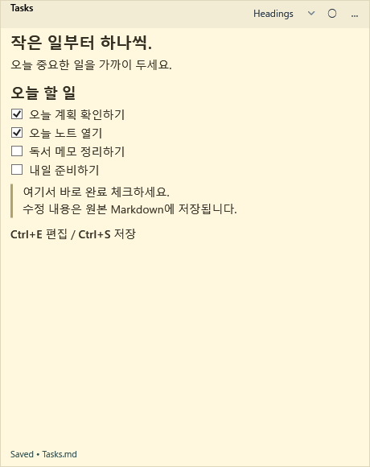
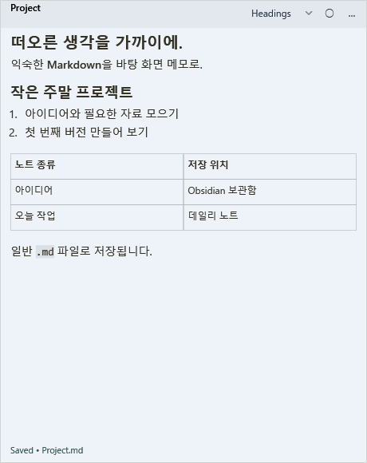
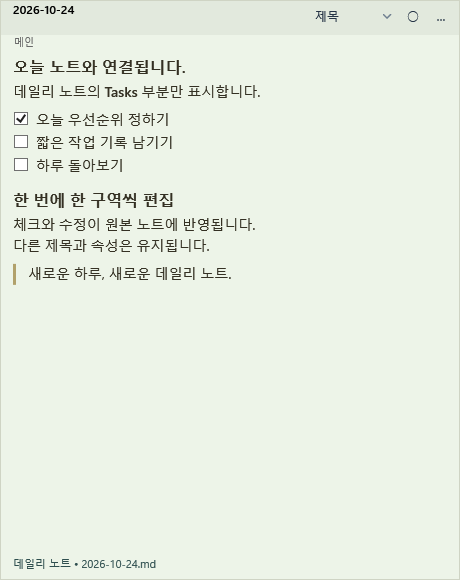

[日本語](README.md) | [English](README.en.md) | [简体中文](README.zh-CN.md) | [繁體中文（台灣）](README.zh-TW.md) | [한국어](README.ko.md) | [Deutsch](README.de.md) | [Русский](README.ru.md) | [Español](README.es.md) | [Svenska](README.sv.md)

# Markdown Sticky Notes

[v0.0.11](https://github.com/AvocadoWasabi/StickyNotes/releases/tag/v0.0.11) · Windows 10 / 11 (x64)

**Obsidian의 오늘 할 일을 바탕 화면에 띄우고, 바로 완료 체크하세요.**

노트 전체나 데일리 노트의 특정 제목 아래 내용을 Windows 메모로 표시합니다. 수정 사항은 원본 Markdown에 저장됩니다. Tasks·Dataview 검색 결과와 Google Calendar 일정도 가까이 두고 확인할 수 있습니다.

[다운로드](https://github.com/AvocadoWasabi/StickyNotes/releases/latest) · [설치 및 설정](docs/INSTALL.ko.md) · [사용 안내(영어)](docs/USAGE.en.md) · [변경 기록(영어)](CHANGELOG.md)

## 이렇게 활용하세요

- **오늘 할 일을 항상 보이게** — 데일리 노트의 Tasks 부분만 표시하고 날짜에 맞춰 전환합니다.
- **노트는 한 곳에서 관리** — 수정과 체크가 원본 `.md`에 반영됩니다. 메모 창을 닫아도 파일은 남습니다.
- **작업 중 빠르게 확인** — 항상 위에 고정하거나 `Alt+Z`로 모든 메모를 10초 동안 앞으로 가져옵니다.

## 화면 예시

| 바로 완료 체크 | Markdown 메모 | 오늘 노트와 연결 |
| :---: | :---: | :---: |
|  |  |  |

v0.0.11의 WPF 컨트롤로 가상 노트를 렌더링한 예시이며, 바탕 화면 캡처가 아닙니다. 노트 본문과 UI 모두 한국어입니다. [9개 언어 예시와 생성 방법](docs/SCREENSHOTS.ko.md).

## 필요한 도구와 설정

**Windows 10 / 11(x64)**. ZIP에 .NET이 포함되어 있으며 관리자 권한이 필요하지 않습니다.

| 사용 목적 | 필요한 도구 | 초기 설정 |
| --- | --- | --- |
| Markdown 메모만 사용 | 이 앱 | 설정에서 **Obsidian CLI 사용(기본값)**를 끄고 로컬 폴더 선택 |
| Obsidian 노트 편집 | 실행 중인 Obsidian＋Obsidian CLI | Obsidian **Settings → General → Command line interface**를 켜고 앱에서 보관함 연결 |
| 오늘의 데일리 노트 | 위 CLI＋코어 **Daily notes** 플러그인 | Obsidian에서 폴더와 날짜 형식을 설정하고 오늘 노트 생성 |
| Tasks 검색과 원래의 체크 동작 | 위 CLI＋커뮤니티 **Tasks** 플러그인 | 대상 보관함에서 활성화. v0.0.11은 정식 **8.2.2 이상** 필요 |
| Dataview 검색 | 위 CLI＋**Dataview** | 대상 보관함에서 활성화. LIST / TABLE / TASK 지원 |
| Google 일정과 할 일 | Google 계정＋직접 구성한 OAuth | Calendar API / Tasks API 활성화, 데스크톱 OAuth JSON 준비 및 [인증(영어)](docs/GOOGLE-CALENDAR.en.md#setup) |

**새 설정에서는 CLI가 기본으로 켜집니다.** Obsidian 없이 사용하려면 끄세요. CLI는 Obsidian 내장 기능이며 Sticky Notes 전용 Obsidian 플러그인은 필요하지 않습니다. [공식 CLI 요구 사항](https://obsidian.md/help/cli) · [호환성과 제한(영어)](docs/TASKS-CLI-PREVIEW.md#english).

## 시작하기

1. [Releases](https://github.com/AvocadoWasabi/StickyNotes/releases/latest)에서 `StickyNotes-win-x64.zip`을 받아 모두 압축 해제하고 `Install.cmd`를 실행합니다.
2. Obsidian에서 CLI를 활성화하고 대상 보관함을 연 뒤 Markdown Sticky Notes를 실행합니다.
3. 앱 설정에서 `Obsidian.com`의 절대 경로를 확인합니다. 보관함 이름／ID를 입력하고 **CLI로 보관함 폴더 가져오기**를 누릅니다. 저장 폴더를 선택한 뒤 **저장 후 닫기**를 누릅니다.
4. `… → 만들기 및 열기`에서 새 메모, 기존 Markdown, 노트의 일부 또는 데일리 노트를 선택합니다.

이 문서는 v0.0.11 기준입니다. 여러 보관함, Tasks 8.2.2 지원, 9개 UI 언어 변경은 [변경 기록(영어)](CHANGELOG.md#v0-0-11)을 참고하세요.

## 기능 목록

| 기능 | 내용 |
| --- | --- |
| Markdown 표시 및 편집 | 제목, 목록, 체크박스, 표, 코드, 링크. 일반 `.md` 파일로 저장 |
| 제목 연결 및 데일리 노트 | 노트 일부 표시／편집, 날짜 전환, 선택적으로 어제 노트 유지 |
| Tasks / Dataview | 검색 결과 표시, 원본 위치가 확인된 할 일 체크, 쿼리 원문 유지 |
| 할 일 입력 | 키워드／날짜 자동 완성, Enter로 목록 계속, Tab 들여쓰기, 체크 단축키 설정 |
| Google 연동 | `@calendar today`로 일정과 날짜가 있는 미완료 Google Tasks 표시. 확인 후 일정 제목／설명 수정 |
| 모양과 창 | 색상, 크기, 50–200% 배율, 항상 위, 임시 앞으로 가져오기, 작업 표시줄 표시 |
| 메모 관리 | 저장 폴더 선택／이동, 닫은 메모 다시 열기, 목록／미리 보기, 이름 변경과 삭제 |
| 데이터 보호 | 쓰기 전 백업, 외부 수정 충돌 감지 |
| 여러 보관함(v0.0.11) | 보관함별 데일리 노트, 이름 변경, 기본 보관함 선택 |

## 기본 조작

| 작업 | 방법 |
| --- | --- |
| 편집 | 본문 클릭(한 번／두 번 클릭 설정 가능) 또는 `Ctrl+E` |
| 저장 후 편집 종료 | `Ctrl+S` / `Esc`. 자동 완성 목록이 열려 있으면 첫 Esc는 목록을 닫습니다 |
| 완료 체크 | 읽기 모드에서 체크박스 클릭 |
| 앞으로 가져오기 | `○ / ●`로 고정. `Alt+Z`로 모든 메모를 10초 동안 앞으로 |
| 닫기／종료 | `… → 이 메모 닫기(파일 유지)`／알림 영역에서 앱 종료 |

## 알아둘 제한 사항

- v0.0.11의 UI·README·설치 안내·화면 예시는 **일본어·영어·중국어 간체·대만 중국어(번체)·한국어·독일어·러시아어·스페인어·스웨덴어**를 지원합니다. 상세 참고 문서는 주로 3개 언어입니다. 언어 변경은 저장 후 재시작하면 적용됩니다.
- CLI 연동 중에는 Obsidian을 계속 실행해야 합니다. 내부 API 변경으로 호환성이 달라질 수 있습니다.
- 데일리 노트는 자동 생성하지 않습니다. 처음 연결하기 전에 오늘 노트를 준비하세요.
- Obsidian 테마와 모든 플러그인 화면을 그대로 재현하지 않습니다. 이미지는 대체 텍스트로 표시하며 DataviewJS·인라인 표현식·CALENDAR는 지원하지 않습니다.
- Google Tasks는 읽기 전용이며 날짜만 가져올 수 있습니다. 예약 시각, Markdown 할 일과의 자동 동기화, 새 일정 생성은 지원하지 않습니다.
- 백업 위치: `%LOCALAPPDATA%/StickyNotes/backups`. 충돌이 나면 작성 내용을 보관하고 다시 불러온 뒤 재시도하세요.

## 상세 안내와 문제 제보

아래 참고 문서는 영어입니다. [저장과 이동](docs/STICKY-FOLDERS.md#english) · [Tasks / CLI](docs/TASKS-CLI-PREVIEW.md#english) · [할 일 입력](docs/TASK-EDITING.md#english) · [Dataview](docs/DATAVIEW.md#english) · [여러 보관함](docs/MULTIPLE-VAULTS.md#english) · [메모 관리](docs/QUERY-EDITING-AND-BROWSER.md#english) · [Google](docs/GOOGLE-CALENDAR.en.md) · [개발](docs/DEVELOPMENT.en.md) · [라이선스 고지](THIRD-PARTY-NOTICES.txt)

[문제와 제안](https://github.com/AvocadoWasabi/StickyNotes/issues)을 등록할 때 앱／Windows／플러그인 버전, CLI 또는 로컬 모드, 재현 절차를 알려 주세요. 개인 노트·OAuth JSON·토큰은 첨부하지 마세요.
