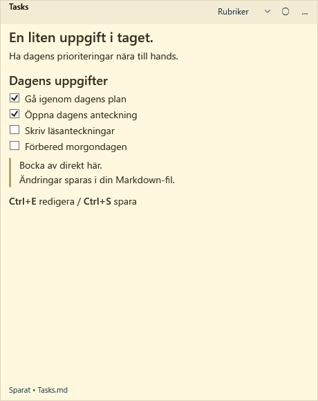
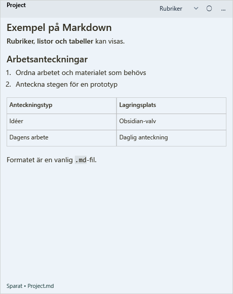
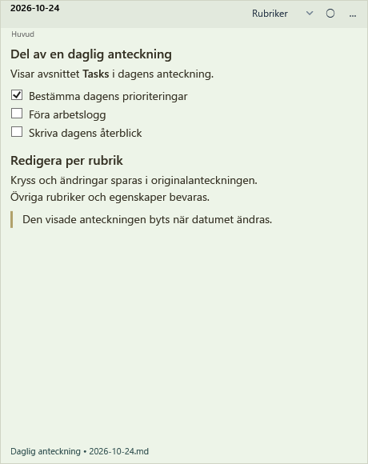

[日本語](README.md) | [English](README.en.md) | [简体中文](README.zh-CN.md) | [繁體中文（台灣）](README.zh-TW.md) | [한국어](README.ko.md) | [Deutsch](README.de.md) | [Русский](README.ru.md) | [Español](README.es.md) | [Svenska](README.sv.md)

# Markdown Sticky Notes

[v0.0.11](https://github.com/AvocadoWasabi/StickyNotes/releases/tag/v0.0.11) · Windows 10 / 11 (x64)

Ett Windows-program för att visa och redigera Markdown-filer i fästisfönster. Det stöder lokala filer, Obsidian-anteckningar och enskilda avsnitt i dagliga anteckningar. Redigeringar och ändringar av kryssrutor sparas i den ursprungliga Markdown-filen.

Programmet visar frågeresultat från Tasks och Dataview via Obsidian CLI och hämtar händelser från Google Calendar och uppgifter från Google Tasks.

[Releases](https://github.com/AvocadoWasabi/StickyNotes/releases/latest) · [Installation och inställningar](docs/INSTALL.sv.md) · [Skärmbilder](docs/SCREENSHOTS.sv.md) · [v0.0.11](CHANGELOG.md#v0-0-11)

## Skärmbilder

| Kryssrutor | Markdown-visning | Avsnitt i en daglig anteckning |
| :---: | :---: | :---: |
|  |  |  |

Exempelanteckningar renderade med programmets WPF-kontroller. Detta är inte skrivbordsbilder. Se [språkexempel och instruktioner för att generera bilder](docs/SCREENSHOTS.sv.md).

## Systemkrav och beroenden

Windows 10 / 11 (x64). .NET ingår i ZIP-filen; administratörsrättigheter behövs inte. CLI är på i nya inställningar: stäng av för lokala filer. Inget särskilt Sticky Notes-tillägg för Obsidian behövs.

| Användning | Krav | Inställning |
| --- | --- | --- |
| Bara Markdown | Den här appen | Stäng av Obsidian CLI och välj en lokal mapp |
| Obsidian-anteckningar | Obsidian igång + inbyggd CLI | Aktivera Settings → General → Command line interface och anslut valvet |
| Dagliga anteckningar | CLI + kärntillägget Daily notes | Ställ in mapp/datumformat och skapa dagens anteckning |
| Tasks-frågor | CLI + tillägget Tasks | Aktivera i rätt valv; v0.0.11 kräver stabil version 8.2.2+ |
| Dataview-frågor | CLI + Dataview | Aktivera i rätt valv; LIST / TABLE / TASK |
| Google | Google-konto + egen OAuth-konfiguration | Aktivera Calendar API / Tasks API, importera OAuth-JSON för skrivbordsapp och godkänn åtkomst |

[Obsidian CLI](https://obsidian.md/help/cli) · [Google OAuth (English)](docs/GOOGLE-CALENDAR.en.md#setup)

## Installation och grundinställningar

1. Hämta `StickyNotes-win-x64.zip` från Releases, packa upp allt och kör `Install.cmd`.
2. Öppna Obsidian, aktivera CLI och håll det valda valvet öppet.
3. Kontrollera den absoluta sökvägen till `Obsidian.com` och valvets namn/ID i appens inställningar. Hämta valvmappen via CLI, välj anteckningsmapp och spara.
4. Skapa/öppna en anteckning eller länka ett avsnitt eller en daglig anteckning under `…`.

Inställningar för lokala filer, uppdatering och avinstallation beskrivs i [installationsguiden](docs/INSTALL.sv.md). Funktioner och inställningar gäller v0.0.11. Ändringar per version finns i [ändringsloggen (på engelska)](CHANGELOG.md#v0-0-11).

## Funktioner

| Funktioner | Användning |
| --- | --- |
| Markdown | Rubriker, listor, kryssrutor, tabeller, kod och länkar; vanliga `.md`-filer |
| Avsnitt och dagliga anteckningar | Visa och redigera ett avsnitt, följa datumbyten och behålla gårdagens anteckning om dagens saknas |
| Tasks / Dataview | Frågeresultat och bockar med verifierad koppling till källan; frågetexten bevaras |
| Uppgiftsinmatning | Förslag på ord/datum, Enter fortsätter listor, Tab ger indrag och kortkommando för kryssruta kan väljas |
| Google | `@calendar today`: händelser och ofärdiga uppgifter med datum; redigera händelsens titel/beskrivning efter bekräftelse |
| Fönster | Färger, storlek, skala 50–200 %, fästning, tillfällig förgrund och visning i aktivitetsfältet |
| Hantering | Välj/flytta lagring, öppna stängda anteckningar, bläddra, förhandsgranska, byt namn och ta bort |
| Säkerhetskopiering och konfliktkontroll | Säkerhetskopior före skrivning och kontroll av externa ändringar |
| Flera valv | Dagliga anteckningar per valv, egna namn och standardvalv |

## Grundläggande användning

| Åtgärd | Metod |
| --- | --- |
| Redigera | Klicka i texten (enkel-/dubbelklick kan väljas) eller `Ctrl+E` |
| Spara och avsluta redigering | `Ctrl+S` / `Esc`; första Esc stänger öppna förslag |
| Bocka av | Klicka på kryssrutan i läsläget |
| Förgrund | Fäst med `○ / ●`; `Alt+Z` visar alla anteckningar framför andra fönster i 10 sekunder |
| Stäng / avsluta | Stäng anteckningen via `…` / avsluta appen från meddelandefältet |

## Stöd och begränsningar

- Gränssnitt, README, installation och bilder finns på de nio språken ovan. Välj språk i inställningarna, spara och starta om. Utförliga referenser är främst på japanska, engelska och förenklad kinesiska.
- Obsidian måste köras för CLI; interna API-ändringar kan påverka kompatibiliteten.
- Dagliga anteckningar skapas inte automatiskt. Skapa dagens anteckning innan du länkar den första gången.
- Obsidian-teman och alla tilläggsvyer återskapas inte. Bilder visas som alternativtext. DataviewJS, inline-uttryck och CALENDAR stöds inte.
- Google Tasks är skrivskyddat; förfallodatum hämtas utan klockslag. Förfallotider, automatisk synkronisering med Markdown-uppgifter och skapande av Google Calendar-händelser stöds inte.
- Säkerhetskopior: `%LOCALAPPDATA%/StickyNotes/backups`. Vid konflikt, behåll utkastet, läs in på nytt och försök igen.

## Dokumentation och felrapporter (på engelska)

[Användning](docs/USAGE.en.md) · [Lagring och flytt](docs/STICKY-FOLDERS.md#english) · [Tasks / CLI](docs/TASKS-CLI-PREVIEW.md#english) · [Uppgiftsinmatning](docs/TASK-EDITING.md#english) · [Dataview](docs/DATAVIEW.md#english) · [Flera valv](docs/MULTIPLE-VAULTS.md#english) · [Anteckningshantering](docs/QUERY-EDITING-AND-BROWSER.md#english) · [Google](docs/GOOGLE-CALENDAR.en.md) · [Utveckling](docs/DEVELOPMENT.en.md) · [Licensinformation](THIRD-PARTY-NOTICES.txt)

Vid felrapportering: ange app-/Windows-/tilläggsversioner, CLI eller lokalt läge och steg för att återskapa felet. Bifoga inte personliga anteckningar, OAuth-JSON eller token. [Issues](https://github.com/AvocadoWasabi/StickyNotes/issues)

## Licens

Den kod och dokumentation i projektet som AvocadoWasabi har upphovsrätten till omfattas av [MIT-licensen](LICENSE). Kod och bibliotek från tredje part behåller sina respektive licenser.

Markdig använder BSD 2-Clause. YamlDotNet, kompletteringskod och testmaterial som härletts från Obsidian Tasks samt .NET / Windows Desktop / System.Security.Cryptography.ProtectedData använder MIT. Upphovsrätt och villkor finns i [tredjepartsinformationen](THIRD-PARTY-NOTICES.txt). ZIP-paketet innehåller projektets LICENSE, tredjepartsinformationen samt .NET-licenser och ytterligare tredjepartsinformation i licenses/.
