[日本語](SCREENSHOTS.md) | [English](SCREENSHOTS.en.md) | [简体中文](SCREENSHOTS.zh-CN.md) | [繁體中文（台灣）](SCREENSHOTS.zh-TW.md) | [한국어](SCREENSHOTS.ko.md) | [Deutsch](SCREENSHOTS.de.md) | [Русский](SCREENSHOTS.ru.md) | [Español](SCREENSHOTS.es.md) | [Svenska](SCREENSHOTS.sv.md)

# 畫面範例與重新產生

以v0.0.11的 WPF 控制項，將虛構筆記繪製為460 × 580 px PNG。這不是桌面擷取畫面，也未實際連線至 Obsidian／Google。不使用個人筆記、設定或憑證。

說明與範例筆記以日文為原本，其他語言為譯文。九種 UI 語言各有三張範例，共 27 張，筆記內文與介面語言一致。台灣華語使用繁體中文（zh-TW）。每日筆記的檔名顯示產生日期。

| 語言 | 核取方塊 | Markdown | 每日筆記 |
| --- | --- | --- | --- |
| 日本語 | [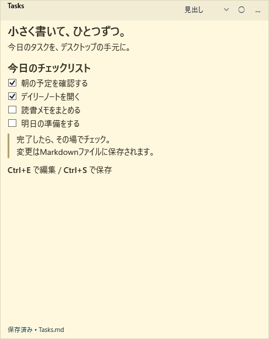](images/sticky-tasks-ja.png) | [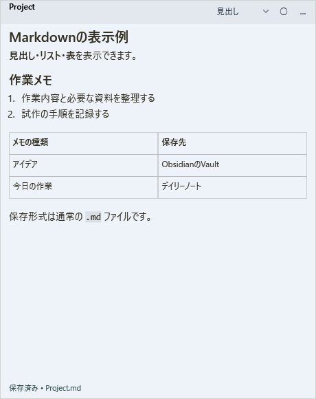](images/sticky-markdown-ja.png) | [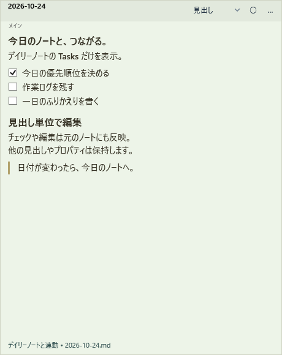](images/sticky-daily-ja.png) |
| English | [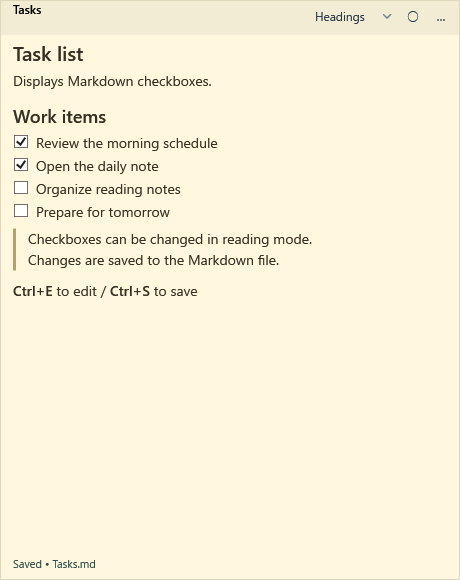](images/sticky-tasks-en.png) | [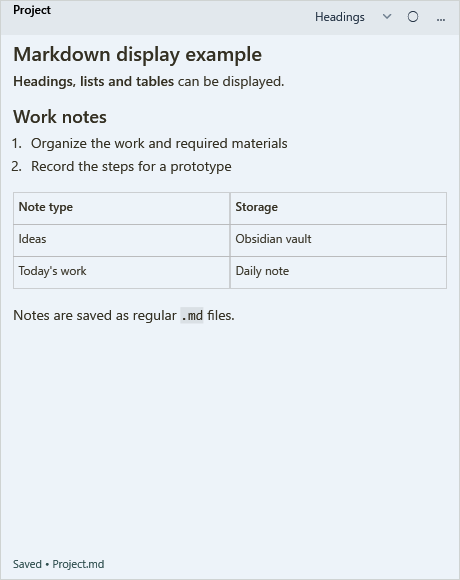](images/sticky-markdown-en.png) | [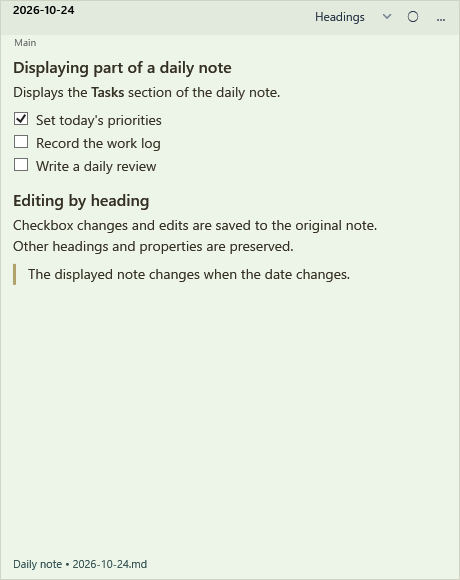](images/sticky-daily-en.png) |
| 简体中文 | [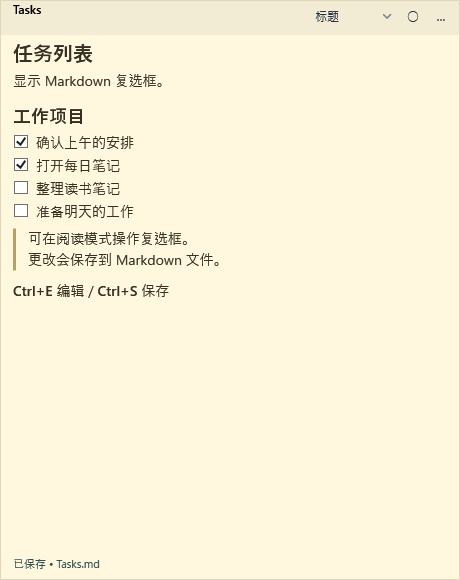](images/sticky-tasks-zh-CN.png) | [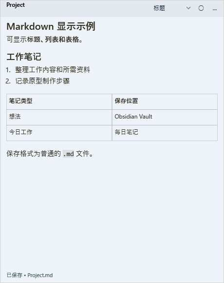](images/sticky-markdown-zh-CN.png) | [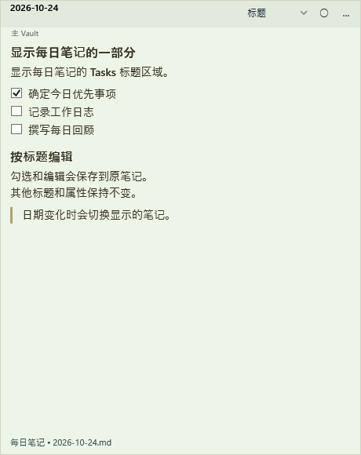](images/sticky-daily-zh-CN.png) |
| 繁體中文（台灣） | [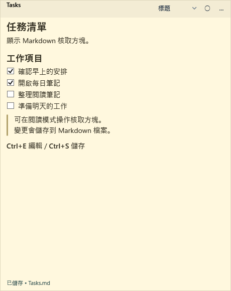](images/sticky-tasks-zh-TW.png) | [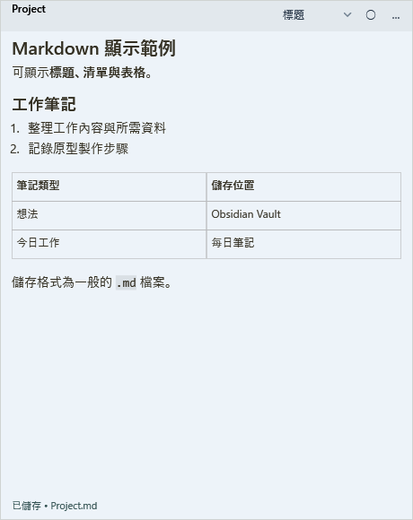](images/sticky-markdown-zh-TW.png) | [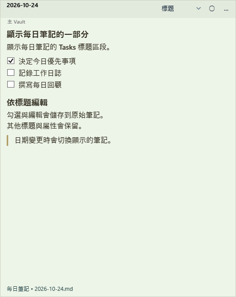](images/sticky-daily-zh-TW.png) |
| 한국어 | [](images/sticky-tasks-ko.png) | [](images/sticky-markdown-ko.png) | [](images/sticky-daily-ko.png) |
| Deutsch | [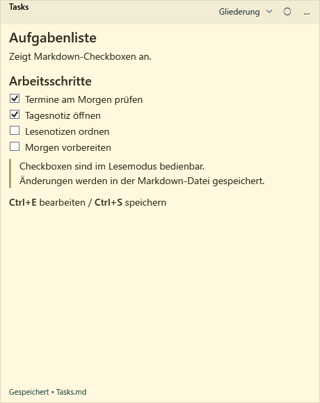](images/sticky-tasks-de.png) | [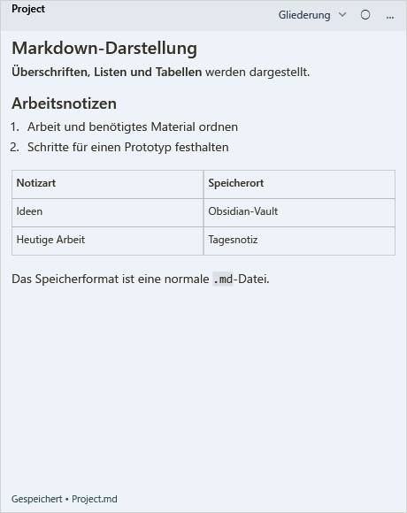](images/sticky-markdown-de.png) | [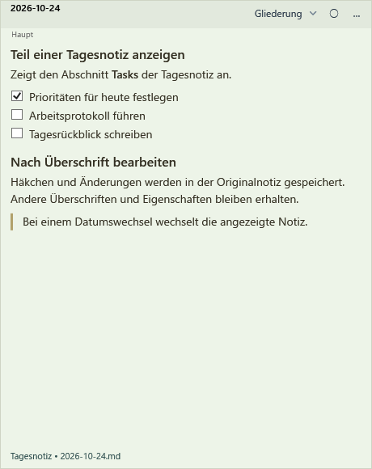](images/sticky-daily-de.png) |
| Русский | [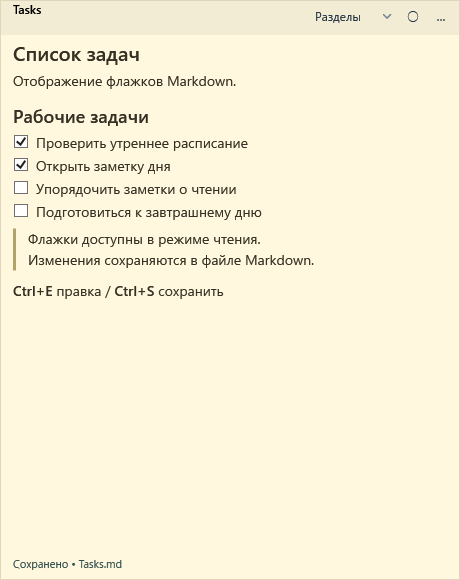](images/sticky-tasks-ru.png) | [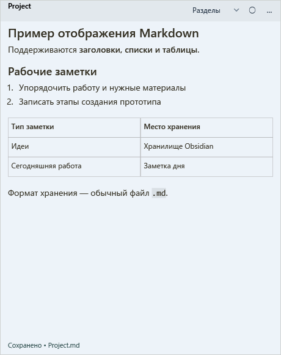](images/sticky-markdown-ru.png) | [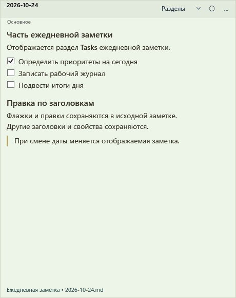](images/sticky-daily-ru.png) |
| Español | [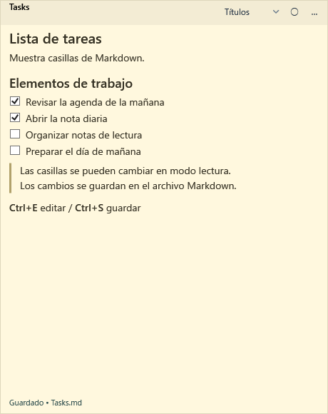](images/sticky-tasks-es.png) | [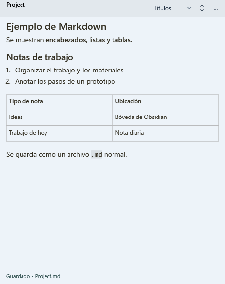](images/sticky-markdown-es.png) | [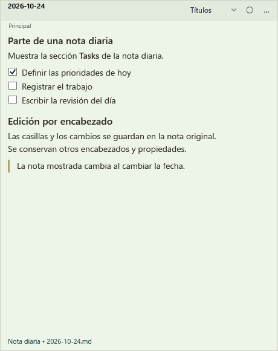](images/sticky-daily-es.png) |
| Svenska | [](images/sticky-tasks-sv.png) | [](images/sticky-markdown-sv.png) | [](images/sticky-daily-sv.png) |

## 重新產生（開發者）

在 Windows 安裝 .NET 8 SDK，從儲存庫根目錄執行。若使用本機 SDK，將 dotnet 換成 .tools/dotnet/dotnet.exe。檢查全部27張圖片的換行、裁切及缺字，並同步九種語言說明。

```powershell
./build.ps1
dotnet run --project tests/StickyNotes.Tests -c Release --no-build -- --render-screenshots examples/screenshots docs/images
```

## 在應用程式中試用

Language 支援 ja / en / zh-CN / zh-TW / ko / de / ru / es / sv。每次執行會在 artifacts 建立新的獨立資料夾，設定所選介面語言並停用 CLI。開啟示範前，請儲存並結束執行中的應用程式。

```powershell
$demoData = ./scripts/Prepare-ScreenshotDemo.ps1 -Language zh-TW
& ./artifacts/app/StickyNotes.exe --data-dir $demoData
```

[日本語](../examples/screenshots/Tasks.md) · [English](../examples/screenshots/en/Tasks.md) · [简体中文](../examples/screenshots/zh-CN/Tasks.md) · [繁體中文（台灣）](../examples/screenshots/zh-TW/Tasks.md) · [한국어](../examples/screenshots/ko/Tasks.md) · [Deutsch](../examples/screenshots/de/Tasks.md) · [Русский](../examples/screenshots/ru/Tasks.md) · [Español](../examples/screenshots/es/Tasks.md) · [Svenska](../examples/screenshots/sv/Tasks.md)

舊 JPEG 與 compact-body-v0.0.9.png 保留作為歷史參考。README 使用新產生的 PNG。
